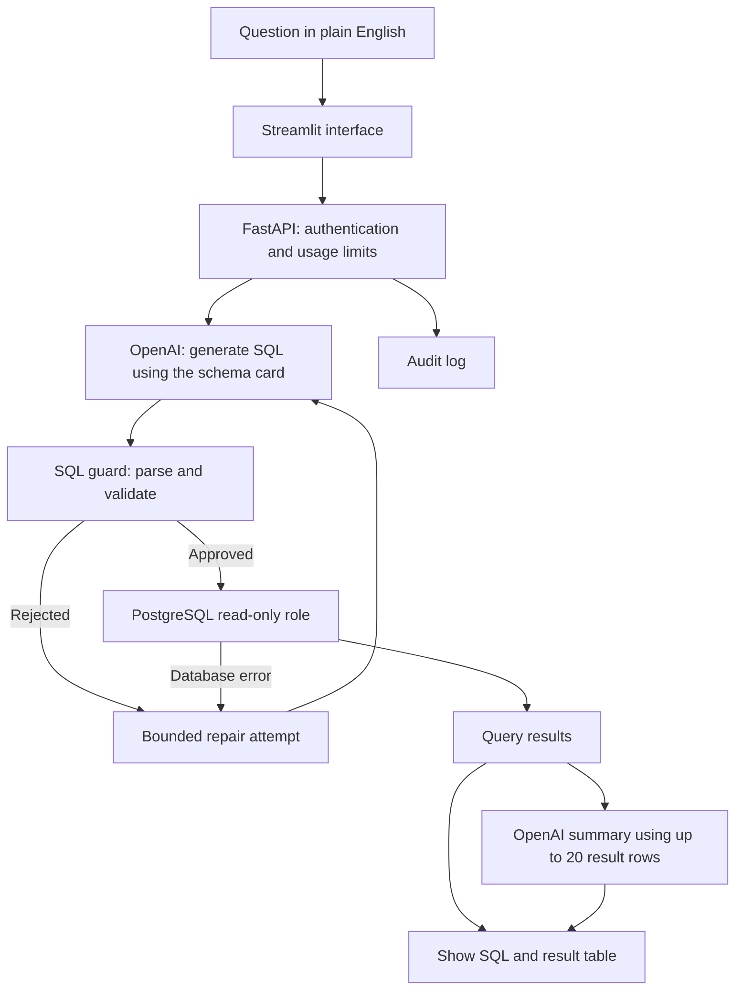

# SQLSentry

**Ask questions about a database in plain English. Get back the SQL, the results, and an explanation — with checks in place before a generated query reaches PostgreSQL.**

SQLSentry is a guarded text-to-SQL assistant built around the Olist Brazilian e-commerce dataset. It is designed to make database exploration easier for someone who may not know SQL, while keeping the generated queries visible and placing limits on what the application is allowed to run.

The idea is straightforward: let an LLM translate a question into SQL, but let PostgreSQL do the actual querying and calculations. The generated SQL is shown alongside the result, so an answer can be inspected rather than taken on trust.

## What it looks like in practice

You can ask questions such as:

- “What are the top 5 product categories by revenue?”
- “Which 3 states have the slowest average delivery time?”
- “How many orders were placed each month in 2017?”
- “What share of payments is made by credit card?”

SQLSentry uses the database schema and project-specific business definitions to draft a query. The query then passes through a validation layer before it is executed. The interface displays the SQL, result table, and a short natural-language summary. Results can also be downloaded as a CSV.

## How a question becomes an answer



At a high level, the application is split into three parts:

1. **Streamlit** provides the interface where a user signs in, asks a question, views the generated SQL and results, and downloads a CSV.
2. **FastAPI** handles authentication, request limits, and the query workflow.
3. **PostgreSQL** stores the Olist data and executes approved queries through a restricted database role.

If a query is rejected by the guard or fails during database execution, the error can be sent back to the SQL generator for a correction. The repair loop is bounded; it does not retry indefinitely.

## Why the LLM does not get unrestricted database access

A natural-language interface is useful, but executing arbitrary model-generated SQL would be a risky design. SQLSentry therefore uses multiple checks rather than relying only on a prompt telling the model to behave.

### 1. SQL validation before execution

The generated statement is parsed with **SQLGlot** and checked before it reaches the database. The guard:

- accepts one read-only `SELECT` query (including supported CTE and set-operation patterns);
- restricts queries to the tables listed in the schema allowlist;
- rejects write and administrative statements such as `INSERT`, `UPDATE`, `DELETE`, `DROP`, and `ALTER`;
- rejects blocked functions, schema-qualified table references, and restricted review-comment columns; and
- adds or lowers a `LIMIT` so a query cannot return more than the configured row cap (1,000 by default).

This is an application-level check, not the only line of defence.

### 2. A restricted PostgreSQL role

Approved queries run through a dedicated read-only database role. That role has `SELECT` access only to the application tables and cannot read the free-text review comments or the audit schema. PostgreSQL is also configured with read-only transactions and a statement timeout (5 seconds by default).

The database permissions are intentionally independent of the SQL guard. If a query somehow gets past the application check, the database role still limits what it can do.

### 3. A separate audit role

Query history is written through a separate database role that can insert and read audit records, but cannot update or delete them. The audit log records information such as the username, question, generated and final SQL, status, number of attempts, row count, and latency.

### 4. Authentication and usage limits

The API uses a shared application password and signed, expiring bearer tokens. It also includes login throttling, an optional username allowlist, a daily per-user question limit, and a global daily limit.

### 5. Limited data sent for summaries

PostgreSQL computes the query result. The summarization step receives only a capped sample of up to 20 result rows, along with the column names and row-count information, to write a short explanation. The full result table is returned to the interface separately, subject to the configured result cap.

## The data behind SQLSentry

The project currently uses the [Olist Brazilian E-Commerce Public Dataset on Kaggle](https://www.kaggle.com/datasets/olistbr/brazilian-ecommerce). It contains marketplace orders and related information from 2016 to 2018. SQLSentry loads eight CSV files into PostgreSQL:

| Table | What it contains |
|---|---|
| `orders` | Order status and purchase/delivery timestamps |
| `order_items` | Products, sellers, item prices, and freight values |
| `order_payments` | Payment types, values, and instalments |
| `order_reviews` | Review scores and timestamps |
| `customers` | Customer and location information |
| `sellers` | Seller and location information |
| `products` | Product attributes and Portuguese category names |
| `product_category_translation` | Portuguese-to-English category names |

The geolocation CSV is not used. The dataset files are not included in this repository; you need to download them from Kaggle and place the required CSVs in `data/` before starting the application.

### Teaching the system what business terms mean

A database schema tells a model which columns exist, but it does not always explain what a business question means. SQLSentry uses [`db/schema_card.yaml`](db/schema_card.yaml) to provide table descriptions, relationships, business definitions, data quirks, and query rules alongside the schema.

A few examples of why that matters:

- **Unique customers:** count `customer_unique_id`, not `customer_id`. The latter is associated with an order, not a distinct person.
- **Revenue:** by default, calculate item revenue from delivered orders using `order_items.price`. Freight is excluded unless shipping is explicitly requested.
- **Order counts:** count distinct order IDs when joins could repeat an order.
- **Items and payments:** aggregate them separately before joining them to orders, so multiple items and multiple payment rows do not accidentally inflate totals.

These definitions are part of the application logic, not just explanatory notes in the README. The schema card is used both when prompting the model and when deriving the table allowlist for validation.

## Technology stack

| Area | Tools |
|---|---|
| Language | Python 3.11+ |
| LLM integration | OpenAI API (default model: `gpt-4o-mini`, configurable) |
| API | FastAPI, Pydantic |
| User interface | Streamlit |
| Database | PostgreSQL 16, SQLAlchemy, Psycopg |
| SQL validation | SQLGlot |
| Data handling | Pandas, PyYAML |
| Containerization | Docker, Docker Compose |
| Testing and evaluation | Pytest, execution-based golden-query evaluation |

## Run SQLSentry locally

### Prerequisites

- Docker Desktop or Docker Engine with the Docker Compose plugin
- An OpenAI API key
- A Kaggle account to download the dataset

The Docker image uses Python 3.11, so you do not need to install the project dependencies on your host just to run the application with Docker Compose.

### 1. Clone the repository

```bash
git clone https://github.com/tejasnidhankarofficial-cyber/sqlsentry.git
cd sqlsentry
```

### 2. Download the Olist dataset

Download and extract the [Olist dataset](https://www.kaggle.com/datasets/olistbr/brazilian-ecommerce) into the repository's `data/` directory. SQLSentry expects these eight files:

```text
data/
├── olist_customers_dataset.csv
├── olist_sellers_dataset.csv
├── olist_products_dataset.csv
├── product_category_name_translation.csv
├── olist_orders_dataset.csv
├── olist_order_items_dataset.csv
├── olist_order_payments_dataset.csv
└── olist_order_reviews_dataset.csv
```

The geolocation file is not required.

### 3. Configure environment variables

Create your local environment file:

```bash
cp .env.example .env
```

Open `.env` and replace the placeholder values. At minimum, set:

- `OPENAI_API_KEY` — your OpenAI API key;
- `APP_PASSWORD` — the password users will enter in the web interface;
- `AUTH_SECRET` — a strong secret used to sign session tokens; and
- the PostgreSQL, read-only, and audit database passwords.

You can generate a value for `AUTH_SECRET` with:

```bash
python3 -c "import secrets; print(secrets.token_urlsafe(32))"
```

You can also set `OPENAI_MODEL`, `ALLOWED_USERS`, `DAILY_LIMIT_PER_USER`, and `DAILY_LIMIT_GLOBAL`. When `ALLOWED_USERS` is empty, any valid username can sign in with the shared application password. Set it to a comma-separated list to restrict usernames.

**Do not commit your `.env` file or real API keys and passwords.** The values in `.env.example` are placeholders, not production credentials.

### 4. Start the application

```bash
make run
```

On the first run, this command builds the application image, starts PostgreSQL, API, and Streamlit services, waits for the services to become healthy, and loads the CSV files when the database is empty and the expected data is present.

Once everything is running, open:

- **Web interface:** [http://127.0.0.1:8501](http://127.0.0.1:8501)
- **FastAPI documentation:** [http://127.0.0.1:8000/docs](http://127.0.0.1:8000/docs)

Sign in with a username permitted by `ALLOWED_USERS` (or any valid username when the allowlist is empty) and the `APP_PASSWORD` configured in `.env`.

If the CSV files are missing when the application starts, the services can still start, but the database will be empty and data questions will not return meaningful results.

### 5. Useful commands

| Command | What it does |
|---|---|
| `make run` | Build and start the database, API, and UI |
| `make status` | Show container status |
| `make logs` | Follow service logs |
| `make restart` | Restart the services |
| `make stop` | Stop and remove containers while keeping database data |
| `make clean` | Stop containers and delete the database volume |
| `make help` | Show available Makefile commands |

**Note:** `make clean` permanently removes the PostgreSQL Docker volume. Use it only when you intend to delete the loaded database and start fresh.

## API overview

The FastAPI service exposes these endpoints:

| Endpoint | Purpose |
|---|---|
| `POST /login` | Verify credentials and return a bearer token |
| `POST /ask` | Generate, validate, execute, and summarize a question |
| `GET /history` | View recent questions shared across the team |
| `GET /usage` | Check the authenticated user's remaining daily quota |
| `GET /health` | Health check |

The interactive API reference is available at `http://127.0.0.1:8000/docs` while the application is running. Endpoints other than login and health require a valid bearer token.

## Testing and evaluation

### Run the test suite

Install the development dependencies and run the tests:

```bash
make setup
make test
```

The test suite covers the SQL guard, API behavior, rate limiting, UI behavior, and evaluation comparison logic. The tests are designed to run without making OpenAI API calls.

### Evaluate generated SQL

```bash
make eval
```

The evaluation uses hand-written reference SQL for answerable questions. SQLSentry generates a query, executes it, and compares the returned rows with the reference result. This measures **execution accuracy** rather than whether the generated SQL string exactly matches the reference query.

The evaluation calls the configured OpenAI model and requires a populated local database. Results are written under `eval/results/`. Because model outputs can vary between runs and the holdout set is limited, treat a single run as an indication of performance rather than a definitive benchmark.

## Limitations and current scope

SQLSentry is a project prototype built around one dataset and a descriptive analytics use case. A few boundaries are important to understand:

- **Dataset-specific:** the schema card, table allowlist, and business definitions are currently written for the Olist dataset. Supporting another database requires updating these pieces and loading compatible data.
- **No conversation memory:** each question is handled independently. Follow-up questions such as “now break that down by state” do not carry context from the previous question.
- **Descriptive, not predictive:** SQLSentry can query historical data, but it does not forecast churn, explain causality, or make predictions.
- **Result limit:** query output is capped at 1,000 rows by default.
- **Shared-password authentication:** when `ALLOWED_USERS` is not configured, anyone with the shared password can choose a valid username. This is not the same as individual identity management.
- **In-memory login throttling:** failed-login tracking is held in process memory and resets when the API process restarts. It is not a distributed rate limiter. Daily usage is counted from the audit log, but in-flight request reservations are process-local, so a multi-worker deployment would need shared coordination for strict concurrent quota enforcement.
- **Deployment hardening:** the included Compose configuration binds service ports to localhost. Do not expose the app or PostgreSQL directly to the public internet. A hosted deployment needs HTTPS, strong secrets, restricted network access, and a review of the authentication and rate-limiting model.

The safety layers reduce the risk of unsafe generated SQL, but this project should not be treated as a formally audited security product or as a substitute for database access controls and deployment security practices.

## Project structure

```text
sqlsentry/
├── app/
│   ├── main.py             # FastAPI routes and application setup
│   ├── pipeline.py         # Generate → guard → execute → repair → summarize → audit
│   ├── generate_sql.py     # OpenAI-based SQL generation
│   ├── sql_guard.py        # SQL parsing and validation
│   ├── execute.py          # Read-only PostgreSQL query execution
│   ├── summarize.py        # Short summaries from a capped result sample
│   ├── audit.py             # Query audit log
│   ├── auth.py              # Password checks and signed tokens
│   ├── ratelimit.py         # Per-user and global daily quotas
│   ├── schema_card.py       # Loads schema context
│   └── config.py            # Environment-based settings
├── ui/
│   └── streamlit_app.py    # Streamlit user interface
├── db/
│   ├── init/               # Database schema, audit schema, and roles
│   └── schema_card.yaml    # Tables, joins, business rules, and query guidance
├── eval/                   # Golden questions, reference SQL, and evaluator
├── scripts/                # Data loading, startup, and utility scripts
├── tests/                  # Automated tests
├── data/                   # Local Olist CSV files (not committed)
├── Dockerfile
├── docker-compose.yml
├── Makefile
├── requirements.txt
└── requirements-dev.txt
```

## Data and license

- **Code:** MIT License. See [`LICENSE`](LICENSE).
- **Dataset:** Olist Brazilian E-Commerce Public Dataset, subject to its [CC BY-NC-SA 4.0 license](https://www.kaggle.com/datasets/olistbr/brazilian-ecommerce). The dataset files are not redistributed in this repository; download them from Kaggle and follow the dataset's attribution and license terms.

---

*SQLSentry is an exploration of how natural-language interfaces, schema-aware prompting, SQL validation, and database permissions can work together to make analytical database queries more approachable and more inspectable.*
